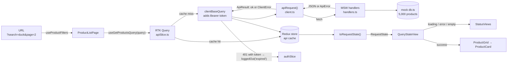
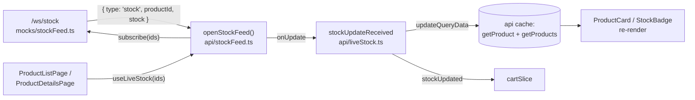

# Architecture

How The Bug Bazaar is put together: where the code lives, how data moves, and where each kind of state is kept. Everything here matches the code on the `dev` branch. File paths are clickable.

## 1. The big picture in one paragraph

A page **asks for data through a hook** (`useGetProductsQuery`). The hook belongs to **RTK Query**, which caches the answer in the Redux store. RTK Query sends the request through **one HTTP client** (`src/api/client.ts`), the only file that calls `fetch`. In development, **MSW** catches the request in the browser and answers from an in-memory database of 5,000 products. The page never sees raw `fetch` results: it gets a **`RequestState`** (loading, error, success) and hands it to **`QueryStateView`**, which shows the right screen. Things that aren't server data, like the cart and the login session, live in **Redux slices**. The product filters live in the **URL**.

## 2. Folder structure

```text
src/
  main.tsx            Entry point: starts the mock API, then renders <App> inside Provider + Router + ErrorBoundary
  App.tsx             Layout (skip link, header, <main>) and the route table
  config.ts           Reads VITE_* env vars once, with safe defaults
  main.css            All styles

  types/              Shared types: no React, no logic
    api.ts              Product, Order, User, ApiError... + type guards for outside data
    request.ts          RequestState<T>: idle | loading | success | error

  api/                The data layer: the ONLY place that talks to the network
    client.ts           apiRequest(): fetch wrapper, returns ApiResult<T> (never throws)
    apiSlice.ts         RTK Query: endpoints, caching, tags, token header, 401 → logout
    requestState.ts     Adapter: RTK Query result → RequestState
    errorMessages.ts    Adapter: technical ClientError → message a shopper understands
    stockFeed.ts        WebSocket client: subscribe, reconnect with backoff, close
    liveStock.ts        Applies a stock update to the cache and the cart

  store/              Client state (Redux Toolkit)
    store.ts            Combines api + cart + auth; saves cart and session to storage
    hooks.ts            Typed useAppDispatch / useAppSelector
    cartSlice.ts        Cart items, quantities clamped to stock, selectors
    authSlice.ts        Session { token, user } and why we logged out
    cartPersistence.ts  Loads the cart from localStorage (validated)
    authPersistence.ts  Loads the session from sessionStorage (validated)

  hooks/              Reusable logic with no markup
    useProductFilters   Filters ↔ URL search params
    useDebouncedValue   Waits until typing stops
    useLocalStorage     useState that survives reloads
    useLiveStock        Opens / closes the stock feed for the page
    useCancelProductRequestOnLeave, useDocumentTitle, useLogout

  pages/              One component per route ("containers": fetch data, decide what to show)
    ProductListPage, ProductDetailsPage, CartPage, CheckoutPage,
    OrderConfirmationPage, LoginPage, AccountPage, NotFound, CrashTestPage

  components/         Building blocks ("presentational": props in, markup out)
    Header, ProductCard, ProductGrid, VirtualProductGrid, FiltersBar, Pagination,
    StockBadge, CartLine, OrderSummary, AddToCartButton, RelatedProducts, BackToTopButton,
    QueryStateView, StatusViews, LiveStockStatus, RequireAuth,
    ErrorBoundary, ErrorFallback, DevPanel

  monitoring/
    logger.ts           logError() + global handlers for errors boundaries can't catch

  utils/              Small pure helpers: formatPrice, storage (safe read/write), navigation

  mocks/              The fake backend (only downloaded when VITE_ENABLE_MOCKS=true)
    browser.ts          Starts MSW in the browser
    handlers.ts         REST endpoints: /api/products, /api/login, /api/orders...
    stockFeed.ts        WebSocket endpoint: /ws/stock
    db.ts               In-memory "database": products, users, orders
    seed.ts             Generates the same 5,000 products every time (seeded random)
    scenarios.ts        Dev panel switches: outage, slow network, sold out, expired session...

  test/               Integration tests + test setup (Vitest + Testing Library + MSW)

docs/                 Written tasks (this file, decisions, API contract...)
scripts/              a11y.mjs (Lighthouse), perf-list.js (list measurement)
.github/workflows/    ci.yml: typecheck, lint, format, test, build on every PR
```

**The rule behind the folders:** each folder may only depend on the ones "below" it.

```text
pages  →  components, hooks  →  api, store  →  types, utils
```

`types/` imports nothing from the app. `api/` doesn't know about React components. Components don't call `fetch`: ESLint fails the build if code outside `src/api/` (and the mocks and tests) uses `fetch` directly (`eslint.config.js`).

## 3. Data flow

### 3a. Reading data (e.g. the product list)



Step by step:

1. **The URL is read** by `useProductFilters`, which turns `?search=duck&page=2` into a typed `ProductFilters` object (invalid values fall back to defaults).
2. **The page calls the hook** `useGetProductsQuery({ search, category, sort, page, ... })`. The search text is debounced first, so typing "duck" makes one request, not four.
3. **RTK Query checks its cache.** Same arguments seen recently? It returns the cached data instantly (and refetches in the background if it's older than 60 s).
4. **Otherwise `clientBaseQuery` runs:** it reads the token from the auth slice and calls `apiRequest()`.
5. **`apiRequest()` calls `fetch`** and turns every outcome into an `ApiResult`: `{ ok: true, data }` or `{ ok: false, error }` with a `status` and `code` (network down → `NETWORK_ERROR`, aborted → `ABORTED`, bad JSON → `INVALID_RESPONSE`). It never throws.
6. **MSW answers** like a real server would, including errors when a Dev panel switch is on.
7. **A 401** while logged in means the session expired: the base query dispatches `loggedOut("expired")`, and the login page explains why.
8. **The result is cached** and every component using that query re-renders.
9. **`toRequestState()`** converts RTK Query's many flags (`isLoading`, `isFetching`, `currentData`...) into one `RequestState`.
10. **`QueryStateView`** shows loading, error (message from `describeError`, with Retry), empty, or calls the page's render function with the typed data.

### 3b. Writing data (placing an order)

```mermaid
sequenceDiagram
  participant C as CheckoutPage
  participant R as RTK Query
  participant S as Server (MSW + db)
  C->>R: createOrder(items, Idempotency-Key)
  R->>S: POST /api/orders + Bearer token + key
  alt success (201; a repeated key gets the SAME order back)
    S-->>R: Order { id, status: "queued" }
    R-->>R: invalidate Product tags of ordered items
    C->>C: clear cart, go to /orders/:id
    Note over C,S: OrderConfirmationPage polls GET /api/orders/:id every 2 s until "completed"
  else 409 out of stock
    S-->>R: ApiError { details: { productId, available } }
    R-->>R: invalidate that product's tag (refetch fresh stock)
    C->>C: lower cart quantity, new key, show message
  else network error / 500
    C->>C: keep the SAME key, show "Try again"
  end
```

Keeping the same idempotency key on a retry is what stops a double order when the server saved the order but its answer was lost (Dev panel: "lose order response").

### 3c. Live updates (WebSocket)



The page tells the server which products it shows. Updates are written straight into the cached data, so the screen changes without a refetch. Leaving the page closes the socket (effect cleanup).

## 4. Where each kind of state lives

| Kind                                              | Where                                            | Examples                                                                                                                               | Why there                                                                                                                       | Survives reload?                                                                                    |
| ------------------------------------------------- | ------------------------------------------------ | -------------------------------------------------------------------------------------------------------------------------------------- | ------------------------------------------------------------------------------------------------------------------------------- | --------------------------------------------------------------------------------------------------- |
| **Server state** (a copy of what the server owns) | RTK Query cache in the Redux store (`api` slice) | Product list pages, one product, an order, the current user                                                                            | The server is the source of truth. We need caching, refetching, loading/error flags and invalidation, which RTK Query gives us. | No (refetched)                                                                                      |
| **Client state, shared**                          | Redux slices                                     | `cart`: items and quantities. `auth`: token, user, logout reason                                                                       | Many pages read it (header count, cart, checkout). It belongs to this browser, not the server.                                  | Cart: yes, `localStorage`. Session: yes until the tab closes, `sessionStorage` (see `docs/auth.md`) |
| **URL state**                                     | Search params, read by `useProductFilters`       | `search`, `category`, `sort`, `inStock`, `page`, `perPage`                                                                             | Shareable links, Back button works, reload keeps the view                                                                       | Yes (it's the address)                                                                              |
| **Local UI state**                                | `useState` inside one component                  | Form fields and errors on Login, the "Added" message, the checkout idempotency key, live feed status, the search box text while typing | Only that component cares about it                                                                                              | No                                                                                                  |
| **Browser preferences**                           | `useLocalStorage`                                | Dev panel switches (`bug-bazaar:mock-scenarios`)                                                                                       | Per-browser test setting, also read by the mock server                                                                          | Yes                                                                                                 |
| **Mock server data**                              | `mocks/db.ts`, orders saved to `localStorage`    | Stock levels, placed orders                                                                                                            | Pretends to be the database. Not app state: the app only sees it through the API                                                | Orders: yes                                                                                         |

**Rules of thumb used:**

- Never copy server data into a Redux slice. The cart stores a **snapshot** of name, price, image and stock (so it can show without fetching), but the stock is corrected by live updates and by the 409 answer at checkout.
- Anything that should be in a shared link goes in the URL.
- Start with `useState`. Move state up only when a second component needs it.

## 5. One choice I can defend: filters live in the URL

**Choice:** the search, category, sort, in-stock and page filters are stored in the URL (`/?search=duck&category=tools&page=2`), not in `useState` or Redux. `useProductFilters` (`src/hooks/useProductFilters.ts`) reads them, validates them and writes them back.

**Why:**

1. **Links work.** Sending someone `/?category=ducks&sort=price-asc` shows them exactly the same list.
2. **Back and Forward work.** Changing a filter adds a history entry, so Back undoes it. With `useState` Back would leave the shop entirely.
3. **Reload keeps your place.** You don't lose page 7 of your search.
4. **One source of truth.** The URL is the state. There's nothing to keep in sync between a Redux copy and the address bar.
5. **Returning from a product** brings you back to the same filtered list: `ProductCard` passes the current URL as `from`, and the details page links back to it.

**Costs, and how they're handled:**

- **The URL is user input.** Anyone can type `?page=-3&sort=banana`. `parseFilters` checks every value with type guards (`isCategory`, `isSortOption`) and falls back to defaults, so bad values never reach the API.
- **Typing would flood the history** with one entry per letter. The first keystroke of a search pushes a history entry; the following ones replace it. The request itself is debounced (300 ms).
- **Default values are left out** of the URL so links stay short (`/` instead of `/?page=1&sort=relevance`).

**Alternative rejected:** Redux for filters. It would make them easy to read anywhere, but loses links, Back and reload, and I'd need to sync it with the URL anyway.

## 6. Design patterns

Three patterns that shape most of the code, where each one is used, and why.

### Pattern 1: Container and presentational components

**What it is:** split a screen into two kinds of components. A **container** gets the data (hooks, store, URL) and decides what to show. A **presentational** component only receives props and returns markup. It doesn't know where the data came from.

**Where it's used:**

| Containers (fetch, decide)                                                                                     | Presentational (props in, markup out)                                                         |
| -------------------------------------------------------------------------------------------------------------- | --------------------------------------------------------------------------------------------- |
| `pages/ProductListPage.tsx`: reads filters from the URL, calls `useGetProductsQuery`, subscribes to live stock | `components/ProductGrid.tsx`: gets `products`, lays them out (and virtualizes big lists)      |
| `pages/ProductDetailsPage.tsx`: reads `:id`, fetches the product                                               | `components/StockBadge.tsx`: gets `stock`, shows "In stock" / "Only 3 left" / "Sold out"      |
| `pages/CartPage.tsx`, `pages/CheckoutPage.tsx`: read the cart, place the order                                 | `components/Pagination.tsx`, `components/FiltersBar.tsx`: get values + an `onChange` callback |

**Why:**

- **Easy to reason about.** All the "where does the data come from?" logic for a screen is in one file: its page.
- **Reusable.** `ProductGrid` shows the main list and also the "More from this category" list (`RelatedProducts`), because it doesn't care which query filled it.
- **Easy to optimize.** Because `ProductCard` only depends on its props, `React.memo` can skip re-rendering the 23 cards that didn't change when one card's stock updates (D4-3).

**Being honest about the edges:** the split isn't 100% pure. `ProductCard` reads `useLocation` (to pass the current list URL as `from`), and `CartLine` dispatches cart actions directly. Passing those down as props from the page would have added a lot of prop drilling for no real gain, so small components are allowed to use a hook when it's about _their own_ job.

### Pattern 2: Custom hooks (reusable logic without markup)

**What it is:** a function whose name starts with `use` that combines React hooks (`useState`, `useEffect`, ...) into one reusable piece of behaviour. Components call it like a built-in hook.

**Where it's used** (`src/hooks/`):

| Hook                             | What it hides                                                         | Used by                                                       |
| -------------------------------- | --------------------------------------------------------------------- | ------------------------------------------------------------- |
| `useProductFilters`              | Reading, validating and writing filters in the URL                    | `ProductListPage`                                             |
| `useDebouncedValue`              | A timer that waits until the value stops changing                     | `ProductListPage` (search)                                    |
| `useLocalStorage`                | `useState` + saving + syncing between tabs (`storage` event)          | `DevPanel`                                                    |
| `useLiveStock`                   | Opening the WebSocket, re-subscribing, closing on leave               | List and details pages                                        |
| `useCancelProductRequestOnLeave` | Aborting the request when the product changes or the page closes      | `ProductDetailsPage`                                          |
| `useDocumentTitle`, `useLogout`  | Setting the tab title; logging out + clearing the cache + redirecting | Every page except the dev crash page; `Header`, `AccountPage` |

**Why:**

- **Pages read like a description.** `const { filters, updateFilters } = useProductFilters()` tells you _what_ happens; the URL parsing lives elsewhere.
- **Cleanup is written once.** Effects that subscribe to something (timer, socket, listener) must undo it. Inside a hook the setup and its cleanup sit side by side, so no page can forget to close the socket.
- **Testable on their own.** `useDebouncedValue` and `useLocalStorage` have unit tests with `renderHook`, and the URL rules of `useProductFilters` (`parseFilters`, `filtersToParams`) are tested as plain functions, all without rendering a page.

### Pattern 3: Adapter (convert outside shapes into our own types)

**What it is:** a small function that converts something we don't control (a library's result, a server's error) into a shape our code is designed around. The rest of the app only knows the adapted shape.

**Where it's used:**

1. **`toRequestState()`** in `src/api/requestState.ts`: RTK Query gives a result with several booleans (`isLoading`, `isFetching`, `isError`, `isUninitialized`) plus `data`, `currentData` and `error`. The adapter turns that into our `RequestState` union: exactly one of `idle | loading | success | error`. It also decides that a request _we_ cancelled counts as "loading", not an error.
2. **`describeError()`** in `src/api/errorMessages.ts`: turns a technical `ClientError` (`409 OUT_OF_STOCK, "Insufficient stock for p-0042: requested 5, available 2"`) into a `UserError` a shopper understands (`Sorry, only 2 of "Rubber Duck" are left.`), with a `kind` that tells the UI which button to show (Retry, Log in, Go back).
3. **`apiRequest()`** in `src/api/client.ts`: adapts `fetch` (which throws on network errors but _not_ on 404/500, and may return non-JSON) into one `ApiResult<T>` that never throws.

**Why:**

- **Impossible states can't happen.** With four separate booleans you could have `isLoading` and `isError` both true. With one `status` (or `kind`) field there's one `switch`, and TypeScript narrows the type in each case: `data` only exists under `"success"`. Where the function declares its return type, a missing case is a compile error: `checkoutMessage(userError): string` in `CheckoutPage.tsx` won't build if a new `UserError` kind is added and not handled.
- **One place to change.** If we swapped RTK Query for another library, `apiSlice.ts` and `toRequestState` would change and pages would call a different hook, but `QueryStateView`, `StatusViews` and every success view wouldn't notice.
- **Server wording stays out of the UI.** Error messages are written for shoppers in one file, instead of each page showing whatever text the server sent.

### Other patterns worth naming (smaller)

- **Render prop:** `QueryStateView`'s `children` is a function `(data) => ReactNode`, called only on success with typed data.
- **Single entry point (facade) for the network:** only `src/api/` may call `fetch`, enforced by ESLint.
- **Idempotency key:** one key per checkout attempt, reused on retry, so the server can't create the order twice (see section 3b).
- **Error boundary:** a class component that catches render errors around the page area and shows a fallback instead of a blank screen (`components/ErrorBoundary.tsx`).
