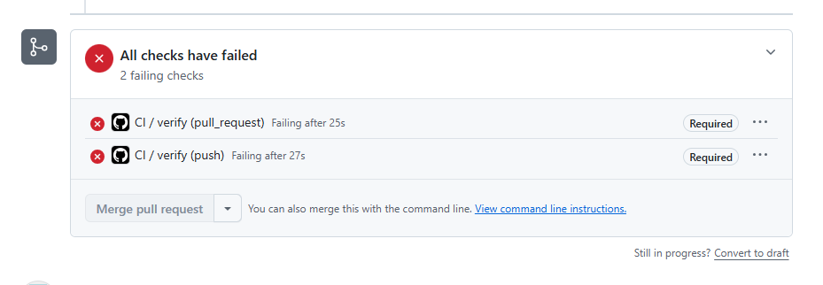

# Decisions

For each task: what I used, what else I considered, and why.

## D1-3: TypeScript

**Used:** TypeScript 5.6 with `strict: true`, plus `noUncheckedIndexedAccess`, `noUnusedLocals` and `noUnusedParameters`. A `npm run typecheck` script (`tsc --noEmit`) and `npm run build` runs it before bundling, so broken types can't ship.

**How the contract is typed:** `src/types/api.ts` holds one type per shape in the shared contract (`Product`, `ApiError`, `ProductsResponse`, `User`, `Order`, ...). The mock server, the data layer and the components all import from this one file.

**How impossible states are prevented:** `src/types/request.ts` defines `RequestState<T>` as a discriminated union:

```ts
| { status: "idle" } | { status: "loading" }
| { status: "success"; data: T } | { status: "error"; error: E }
```

Before, the app had three separate `useState` calls (`loading`, `error`, `bugs`). Nothing stopped `loading: true` and `error: "..."` at the same time. With the union, only one variant exists at a time, and TypeScript won't let a component read `data` without first checking `status === "success"`.

**Considered:**

- _Keeping JavaScript with JSDoc types._ Rejected: TypeScript is a fixed requirement, and JSDoc checks are weaker and easy to skip.
- _Loose mode first, strict later._ Rejected: the codebase is small, so going straight to strict was cheap. Turning it on later always costs more.
- _Boolean flags (`isLoading`, `isError`)._ Rejected for the reason above: they allow impossible combinations.

**Rule:** no `any` and no `@ts-ignore`. When TypeScript doesn't know a type (for example `catch (err)`), we narrow `unknown` with checks like `err instanceof Error`.

## D1-1: Setup

**Used:**

- **ESLint 9** (flat config) with `typescript-eslint`, `react-hooks` and `react-refresh`. It finds real bugs (missing effect dependencies, hooks called conditionally) and enforces the TypeScript rules: no `any`, no `@ts-ignore` / `@ts-expect-error`, `import type` for types.
- **Prettier** for formatting, plus `eslint-config-prettier` so ESLint never reports formatting. Each tool does one job.
- **`.editorconfig`, `.gitattributes`, `.vscode/`**: the same indentation and LF line endings on every OS and editor, plus format-on-save in VS Code.
- **Environment variables**: listed in `.env.example`, typed in `src/vite-env.d.ts`, and read in one place (`src/config.ts`) with defaults. The app runs without a `.env` file, which keeps setup under 5 minutes.
- **A layered folder structure** (`api/`, `mocks/`, `store/`, `pages/`, `components/`, `hooks/`, `types/`, `utils/`). Each folder holds one kind of code, so it's obvious where a new file goes.
- `npm run check` runs typecheck + lint + format check in one command. CI will reuse it (D4-6).

**Considered:**

- _Biome_ (one fast tool for lint + format). Rejected: smaller plugin ecosystem, with no official React Hooks rules equivalent to `eslint-plugin-react-hooks`.
- _ESLint only, with its formatting rules._ Rejected: those rules are deprecated, and Prettier is the standard.
- _Feature folders_ (`features/cart/` holding that feature's slice, components and pages). A good fit for bigger apps. For a store this size, the layered structure is simpler to navigate and explain.
- _Husky pre-commit hooks._ Skipped: CI (D4-6) enforces the same checks on every pull request without slowing down each local commit.

## D1-2: HTTP and API contracts

**Used:** **MSW (Mock Service Worker)** v2. A service worker intercepts `fetch` in the browser and answers from `src/mocks/handlers.ts` with real HTTP status codes and JSON bodies. The contract is documented in `docs/api-contract.md` and typed in `src/types/api.ts`.

- **Data:** 5,000 products generated from a fixed seed (`src/mocks/seed.ts`), so ids and stock are the same on every load and in tests.
- **Logic separate from HTTP:** `db.ts` holds the "server" rules (search, sort, stock, orders, tokens). `handlers.ts` only turns results into status codes. The checks run in the same order as a real server: outage → 401 → 400 → 404/409 → success.
- **Triggering errors:** natural triggers where possible (wrong password → 401, unknown id → 404, too many → 409), plus Dev panel switches stored in `localStorage` for the rest (500, forced 409, expired session, slow network).
- **Persistence:** orders and stock changes are saved in `localStorage`, so an order confirmation page still works after a refresh.
- **Idempotency** is enforced on the server side, through the `Idempotency-Key` header (used by checkout in D3-2).

**Considered:**

- _A hand-written fake `fetch` / fake API module._ Simpler, but it skips real HTTP: no status codes, nothing in the Network tab, and app code that differs from production.
- _json-server or a small Express server._ Real HTTP, but it's a second process to run and harder to reset per test. It would also push setup past the 5-minute goal.
- _MSW_ was chosen because the app code is identical to what it would be with a real backend (only `VITE_ENABLE_MOCKS` changes), and the same handlers run in the Vitest tests (D4-5) through `msw/node`.

**Trade-offs:** the 5,000 products are generated in the browser (~1 ms). The mock code only loads when mocks are on (dynamic `import()`). Tokens are base64, not signed, which is fine for a mock but must never be done in a real system.

## D1-4: Data layer

**Used:** two layers, and components only ever talk to the top one.

1. **`src/api/client.ts`** is the only code that calls `fetch`. It builds the URL from `config.apiBaseUrl`, sets JSON and auth headers, passes an `AbortSignal`, parses JSON, and turns every failure (4xx/5xx, offline, aborted) into one `ClientError` shape. It returns a result union (`{ ok: true, data } | { ok: false, error }`) instead of throwing, so callers can't forget the error case.
2. **RTK Query** (`src/api/apiSlice.ts`) declares the endpoints once and generates hooks (`useGetProductsQuery`). Its base query just calls `apiRequest`, so every request still goes through the client.
3. **`src/api/requestState.ts`** is an adapter that converts RTK Query's booleans (`isLoading`, `isError`...) into our `RequestState` union, so components handle every state with one `switch`. It reads `currentData`, not `data`, so a component never shows results that belong to an older argument (protects D2-4 and D2-6).

**Enforced, not just promised:** ESLint's `no-restricted-globals` / `no-restricted-properties` make `fetch`, `window.fetch` and `XMLHttpRequest` errors everywhere outside `src/api/` and `src/mocks/`.

**Considered:**

- _A plain `fetch` wrapper plus our own `useApi` hook._ Simple, but we'd have to build caching, de-duplication and cache invalidation ourselves (D3-5).
- _TanStack Query._ Excellent, but D3-1 already needs Redux Toolkit, and RTK Query gives the same features inside the same store and devtools.
- _axios._ Adds interceptors, but `fetch` plus a 100-line wrapper covers our needs without a dependency.
- _Runtime validation of responses (zod)._ The client trusts that a 2xx body matches the contract (`body as T`). Validating with a schema would catch a backend that breaks the contract. Worth adding with a real backend; skipped for a mock we control.

**Debugging note (the stuck "Loading..." bug):** while testing, the page sometimes stayed on "Loading..." even though the store showed `rejected`. Dispatching a no-op action made the error appear, which proved the state was right and only the re-render notification was delayed. The cause: Redux Toolkit 2's `configureStore` adds an auto-batch enhancer that delivers RTK Query notifications on `requestAnimationFrame`, and browsers pause `requestAnimationFrame` in hidden tabs. My test browser pane was hidden. In a visible tab the update arrives on the next frame, so we kept the default (it saves re-renders). Tests in jsdom (D4-5) must account for it.

## D2-1: Product list

**Used:**

- **`formatPrice(cents)`** (`src/utils/formatPrice.ts`) is the only place cents become text. It uses one shared `Intl.NumberFormat("en-US", { style: "currency", currency: "USD" })`, which always shows 2 decimals and thousands separators (`124900` → `$1,249.00`). Prices stay integers everywhere else, because floating point can't represent most decimals exactly (`0.1 + 0.2 === 0.30000000000000004`).
- **Small components, one job each:** `ProductGrid` (layout), `ProductCard` (one product), `StockBadge` (stock text, shared by card and details page). Pages are **containers** that fetch data and pick the state. Components are **presentational**: props in, UI out.
- **Keyboard support through semantic HTML:** the product name is a real `<Link>` and the **only** focusable element in each card. A CSS "stretched link" (`::after` with `inset: 0`) makes the whole card clickable for mouse users. Keyboard users get exactly one Tab stop per product, Enter opens it, and `:focus-within` outlines the whole card. The grid is a `<ul>`, so screen readers announce the item count.
- **Details page** reads `:id` with `useParams` and uses `skipToken` when there's no id. A 404 shows a Not Found screen (retrying wouldn't help). Other errors show Try again.
- **Responsive grid** with `repeat(auto-fill, minmax(220px, 1fr))`: from 1 column on a phone to 5 on a wide screen, with no media queries.

**Considered:**

- _Making the whole card a `<Link>`._ Simple, but the D3-2 "Add to cart" button couldn't go inside it (interactive elements can't be nested), and screen readers would read the entire card as one long link name.
- _Arrow-key navigation (roving `tabindex`)._ Useful for app-like widgets, but a product grid is a list of links, and users expect Tab to work. One Tab stop per card keeps it short.
- _A `formatPrice` that divides with `toFixed(2)`._ Works for dollars, but has no currency symbol or thousands separator, and isn't locale-aware.

## D2-2: Filters

**Used:** **the URL is the only place filters live.** `useProductFilters` (`src/hooks/useProductFilters.ts`) reads them with React Router's `useSearchParams`, validates them, and writes changes back to the URL. There's no `useState` copy, so nothing can drift out of sync.

- **Refresh / shared link:** the full view (`?search=debug&category=ducks&inStock=true&sort=price-asc&page=2`) is in the address bar, so reloading or pasting the link rebuilds exactly the same view.
- **Back button:** every category / sort / in-stock / page change **pushes** a history entry. While typing a search, the first keystroke pushes and the rest **replace**, so typing "duck" is one Back step, not four. (The first version replaced on every keystroke, which overwrote the previous view in history. Testing Back caught it.)
- **Validation:** `parseFilters` treats the URL as untrusted input. Unknown categories, unknown sorts, and pages that aren't positive whole numbers fall back to defaults. `?page=999` shows "This page doesn't exist" with a link to page 1.
- **Short, canonical URLs:** `filtersToParams` leaves out default values, so the same view always has the same URL.
- **Changing a filter resets to page 1**, because page 7 of the old results may not exist in the new ones.
- **Back to products** on the details page returns to the same filtered list: the card passes `{ from: "/?..." }` as router state. Opened from a shared link, the state is missing and the link falls back to `/`.
- **Result count** is in a `role="status"` element, so screen readers announce it when it changes.

**Considered:**

- _Filters in `useState`._ Fails all three criteria: lost on refresh, not in the link, invisible to the Back button.
- _Filters in Redux._ Survives navigation but not refresh, and isn't shareable. It would also be a second copy of what the URL already says.
- _Filtering the 5,000 products in the browser._ Fast enough, but the contract defines server-side `search/category/sort/page`, and that's how a real catalogue scales.
- _`navigate(-1)` for "Back to products"._ Breaks when the page was opened from a shared link (it would leave the site). Router state with a `/` fallback handles both cases.

## D2-3: UI states

**Used:** one set of state views, so consistency doesn't depend on remembering to copy markup.

- **`LoadingState`, `ErrorState`, `EmptyState`** (`src/components/StatusViews.tsx`) are the only loading/error/empty markup in the app. Loading uses `role="status"`, and errors use `role="alert"` so screen readers announce them immediately. The spinner switches to a gentle pulse when the OS asks for reduced motion.
- **`QueryStateView`** (`src/components/QueryStateView.tsx`) takes a `RequestState` and picks the view. Pages only pass labels, an optional `isEmpty` check, and a **render prop** (`children: (data) => ReactNode`) that's called only when data exists, already typed.
- **`describeError`** (`src/api/errorMessages.ts`) turns a `ClientError` into friendly text and decides whether retrying makes sense. Raw messages from the server never reach the screen.
- **Retry** calls RTK Query's `refetch()`. While it runs, the adapter reports `loading`, so the user sees the same loading view, then success or the error again.
- **404 on the details page** shows the Not Found page instead of an error, because retrying can't make a missing product appear.

**How to trigger each state** (🛠 Dev tools, bottom-right):

| State   | Product list                                      | Product details                   |
| ------- | ------------------------------------------------- | --------------------------------- |
| Loading | **Slow network** (+2-4 s)                         | **Slow network**                  |
| Error   | **Product list fails (500)** or **Server outage** | **Server outage**                 |
| Retry   | Turn the switch off, click **Try again**          | Same                              |
| Empty   | Search for `zzzz`, or open `/?page=999`           | (n/a: a missing product is a 404) |
| 404     | (n/a)                                             | Open `/products/nope`             |
| Success | All switches off                                  | All switches off                  |

**Considered:**

- _A `switch` in every page._ That's what the pages had before. It works, but each page drifted (different text, roles and markup), which is exactly what "consistent" rules out.
- _React Suspense + error boundaries for data loading._ Elegant, but RTK Query's hooks don't suspend by default, and an error boundary is meant for unexpected crashes (D4-7), not expected API errors with a retry.
- _Skeleton cards instead of a spinner for the list._ Nicer perceived performance, but a different look per page. Kept one loading style for consistency.

## D2-4: useEffect and cleanup

**Used:**

- **Never the wrong product:** pages read RTK Query's `currentData`, which only holds data for the **current** id (D1-4). A slow response for a product you already left can't be shown.
- **Cancelling in-flight requests:** `useCancelProductRequestOnLeave(id)` has a cleanup that aborts the product's still-running request (`api.util.getRunningQueryThunk(...).abort()`) when the id changes or the page closes. The abort reaches `fetch` through the `AbortSignal` that `client.ts` passes along, so the browser really stops the request (`ERR_ABORTED` in the Network tab).
- **StrictMode-safe:** in development React runs effects _set up → clean up → set up_ to catch missing cleanups. The cleanup therefore schedules the abort for the next tick, and a re-run for the **same** id un-schedules it. Without that, dev mode would cancel the request the page is about to use.
- **Cancelled ≠ failed:** the adapter (`requestState.ts`) reports an aborted request as `loading`, so returning to a product whose request was cancelled never flashes an error.
- **Back to Top** (`BackToTopButton`): a `scroll` listener (`passive: true`) that schedules at most one state update per frame with `requestAnimationFrame`. The cleanup removes the listener **and** cancels any pending frame. Clicking it respects `prefers-reduced-motion` and moves focus to `<main>`, because the button disappears.
- **Scroll reset** when the product id changes (`useEffect(..., [id])`), because React Router keeps the scroll position between routes.
- **"More from this category"** on the details page gives a realistic way to switch products quickly, and makes the page long enough for Back to Top.

**Verified:** with Slow network on (responses arrive out of order), switching p-0101 → p-0202 → p-0303 150 ms apart showed p-0303, and the first two requests were `ERR_ABORTED`. Leaving a loading product cancelled its request. Wrapping `add/removeEventListener` showed 2 scroll listeners added and 2 removed after leaving the page (StrictMode adds one extra and removes it).

**Considered:**

- _Only relying on `currentData`._ Correct display, but the old request keeps running. The task asks for cleanup of in-flight requests.
- _Our own `useEffect` + `AbortController` + `fetch` for the details page._ The classic pattern, but it would bypass the cache (D3-5) and duplicate what RTK Query already does. We use RTK Query's own abort, which uses an `AbortController` internally.
- _Aborting immediately in the cleanup._ Breaks in StrictMode (described above).
- _Throttling scroll with `setTimeout`._ `requestAnimationFrame` matches the screen refresh rate and is paused in background tabs, so it's cheaper and smoother.

## D2-5: Custom hooks

**Used:** two generic, typed hooks that know nothing about products, built on one shared helper module.

| Hook                                        | What it does                                                                                         | Used by                                         | Duplication it removes                                                                                                   |
| ------------------------------------------- | ---------------------------------------------------------------------------------------------------- | ----------------------------------------------- | ------------------------------------------------------------------------------------------------------------------------ |
| `useLocalStorage<T>(key, default, isValid)` | `useState` that's saved to localStorage, validated on read, and synced across tabs (`storage` event) | Dev panel (and the "remember me" pattern later) | The Dev panel kept `useState` and storage in sync by hand. `scenarios.ts` had its own read/parse/validate/try-catch code |
| `useDebouncedValue<T>(value, ms)`           | Returns the value once it has stopped changing for `ms`                                              | Product search (300 ms)                         | Timer + cleanup logic that would otherwise be rewritten for every debounced input                                        |

- **`src/utils/storage.ts`** (`readStorage`, `writeStorage`, `removeStorage`, `isRecord`) is the single copy of the safe localStorage logic. It's plain functions, not hooks, because the mock API (`scenarios.ts`) and the cart persistence (D3-2) run outside React components.
- **Validation by type guard:** `readStorage<T>(key, isValid)` only returns a `T` if `isValid` says so. Corrupt or old data falls back to the default instead of crashing.
- **Debounce effect:** the search box and URL still update on every keystroke (instant feedback, and Back still works). Only the request waits. Typing "keyboard" sends **1** request instead of 8.
- Other custom hooks in the app: `useProductFilters` (URL ↔ typed filters, D2-2) and `useCancelProductRequestOnLeave` (D2-4).

**Verified:** typing "keyboard" quickly → one `search=keyboard` request. A Dev panel switch toggled in one tab updated another tab without a reload. Corrupt JSON in storage → defaults, and storage repaired.

**Considered:**

- _A `useDebouncedCallback` (debounce the function instead of the value)._ Useful for "save after typing", but a debounced **value** fits better as a query argument and needs no `useRef` juggling.
- _lodash.debounce / usehooks-ts._ Fine libraries, but each hook is under 25 lines, and writing them shows how the cleanup works.
- _Functional updates in `useLocalStorage` (`setValue(prev => ...)`)._ Left out to keep the API simple. The Dev panel computes the next value from the current one directly.

## D2-6: Race conditions

**The problem:** replies don't have to come back in the order requests were sent. With naive code (`fetch(...).then(data => setProducts(data))`), whichever reply arrives **last** wins, even if it's for an older query.

**Simulation:** the Dev panel switch **Out-of-order search** makes the mock delay each search by `2600 ms − 600 ms × letters`, so "d" answers last (2.0 s) and "duck" first (0.2 s).

**Proof the bug is real:** a console script with naive "last response wins" logic sent `d, du, duc, duck` 350 ms apart. Replies arrived `duck, duc, du, d`, and the naive screen ended on **3,171 results for "d"** while the box said "duck" (correct: 1,278).

**How the store avoids it (layered):**

1. **Debounce (D2-5):** fast typing sends one request. This reduces the race but doesn't prevent it: a user who pauses longer than 300 ms between letters still sends several.
2. **Cache keyed by query + `currentData`:** RTK Query stores each reply under **its own** arguments, and our adapter reads `currentData`, the entry for the **current** arguments only. A late reply for "d" fills the "d" entry and can never replace "duck". The rule is "show the answer to the current question", not "show the last answer".
3. **No stale results while typing:** during the 300 ms debounce window the box already says "duck" while the last request was for "du". The page compares the box with the debounced query and shows "Searching…" until they match, so the result list and count always belong to the text in the box.

**Verified in the UI:** with the switch on, typing d / u / c / k with 350 ms pauses sent all four requests, and "d" answered last. A recorder sampled the screen every 100 ms: 47 samples, 28 showing results, **0 showing results for a different query than the box**. Final screen: 1,278 / p-0013 (duck).

**Considered:**

- _A "request id" check (`if (id !== latestId.current) return`) or an `ignore` flag in the effect cleanup._ The classic fix for hand-written `useEffect` fetching, and how I'd do it without RTK Query. Keying results by query solves the same problem, and also caches them.
- _Aborting older search requests._ That saves bandwidth, but the late replies are still useful: they're cached, so deleting back from "duck" to "du" shows results instantly. Correctness doesn't depend on aborting. (For product details we do abort, D2-4, because the task asked for cleanup there.)
- _Showing the previous results dimmed while searching._ Nicer for some users, but it would still show an old query's results and count, which this task rules out.

## D3-1: Redux Toolkit

**Used:** Redux Toolkit slices for the two kinds of shared **client** state:

- **`cartSlice`**: `{ items: CartItem[] }`. Reducers `itemAdded`, `quantityChanged`, `itemRemoved`, `cartCleared` are the **only** ways the cart changes. Action names describe what happened, and the reducer decides how state changes. The stock limit (`clampQuantity`) lives in the reducer, so no component can bypass it.
- **`authSlice`**: `{ session: { token, user } | null }`. One value instead of separate `token`/`user` fields, so "token without user" can't exist. Reducers `loggedIn` / `loggedOut` (wired up in D3-3).
- **Derived values:** only the items are stored. `selectCartCount` and `selectCartTotal` are memoized selectors (`createSelector`) that compute count and total (in cents) from the items, so they can never drift out of sync. The header badge (`Header.tsx`) reads `selectCartCount`.
- **Where state lives now:** server data → RTK Query cache (`state.api`). Cart and session → Redux slices. Filters → URL. Form inputs and toggles → component state.

**"State only changes through defined updates," enforced:** Immer freezes the state in development, so pushing to `cart.items` from outside a reducer throws `TypeError: object is not extensible`, and assigning `item.quantity = 99` throws `Cannot assign to read only property` (in strict-mode code, which all ES modules are). Dispatching `quantityChanged` with 999 for a product with 11 in stock results in 11, because the reducer applies its rules.

**Considered:**

- _React Context + `useReducer`._ Fine for small apps, but every consumer re-renders on any change, and there are no devtools or memoized selectors. D3-1 also asks for Redux Toolkit specifically.
- _Storing `count` and `total` in the slice._ Rejected: two sources of truth. Every reducer would have to remember to update them.
- _`createEntityAdapter` (items normalised by id)._ Good for large collections. A cart has a handful of lines, and a plain array is simpler to read and explain.
- _Storing only `productId` + `quantity` and looking up products from the API cache._ The cart page would then depend on cache entries that may have expired. A small snapshot (name, price, image, stock) keeps it self-contained, and the server re-checks stock and price at checkout.

## D3-2: Cart

**Used:**

- **Quantities can't exceed stock, enforced twice:** the cart reducer clamps every quantity to `0..stock` (D3-1), and the quantity picker is a `<select>` that only offers `1..stock`, so the UI can't even express an invalid quantity (no "0", "-3" or empty box).
- **Survives a reload:** `store.ts` subscribes to the store and saves `state.cart` to localStorage whenever it changes (a reference check: immutable state means "changed" = "different object"). On start-up, `loadCart()` reads it back as `preloadedState`, validated by the `isCartState` type guard, so a tampered or old cart (e.g. `quantity: -5`) becomes an empty cart instead of a crash.
- **Checkout** (`/checkout`) uses an RTK Query **mutation** (`createOrder`). The token is added once, in the base query, from `state.auth`. On success: go to `/orders/:id` and dispatch `cartCleared()`.
- **No duplicate orders, two layers:**
  1. The Place order button is disabled while a request is in flight (no double-click double-submit).
  2. **Idempotency key:** the checkout page generates one `crypto.randomUUID()` per order attempt and sends it as `Idempotency-Key` on **every retry of that same order**. The server stores key → order and returns the existing order for a repeated key. This covers the case the button can't: the order was saved but the reply was lost, and the user retries. Rule: same request → same key. After a 409 the cart changes, so the next attempt gets a **new** key.
- **409 names the item:** the error's `details` carry `productName` and `available`. The page shows "Sorry, only 1 of "Glow Debug Duck #42" is left. We've updated your cart…", and dispatches `stockUpdated` so the cart drops to the real stock (or removes a sold-out line). Raw server text is never shown.
- **Order confirmation** (`/orders/:id`) polls `GET /orders/:id` every 2 s until the status is `completed`, then stops. RTK Query's `pollingInterval` timer is cleared automatically when the page closes.

**Verified in the browser:**

| Criterion             | Result                                                                                                                                                                                                                                       |
| --------------------- | -------------------------------------------------------------------------------------------------------------------------------------------------------------------------------------------------------------------------------------------- |
| Quantities ≤ stock    | Picker offered exactly 1..11 for a product with 11 in stock                                                                                                                                                                                  |
| Survives reload       | 3 × duck, $74.97 before and after a full reload; a tampered cart (quantity −5) loaded as empty                                                                                                                                               |
| 409 names the item    | Another customer bought 10 of 11; placing 3 showed "Sorry, only 1 of "Glow Debug Duck #42" is left…" and the cart dropped to 1                                                                                                               |
| No duplicate on retry | With **Checkout: order saved, reply lost (500)** on, the first attempt saved the order but showed an error. The retry sent the **same** key (`66ce68fc-…`), got the same order back, and the result was 1 new order and stock 1 → 0 (not −1) |
| Polling stops         | Status went Processing → Confirmed, then 0 new requests in the next 6 s                                                                                                                                                                      |

**Considered:**

- _Disabling the button only._ Stops double-clicks, but not a retry after a lost reply. That's the case that causes real double charges.
- _Deriving the key from the cart contents (a hash)._ Buying the same cart again tomorrow would reuse the key, and the server would return yesterday's order. A random key per attempt avoids that.
- _Keeping the key across page reloads (e.g. stored with the cart)._ Would also cover "reply lost, then the user reloads and retries". Left out to keep the flow simple. The server-side idempotency is what makes adding it easy later.
- _Number input with +/− buttons._ Familiar, but needs extra handling for empty or invalid input while typing. The `<select>` is accessible by default and can't be invalid.

**Not yet:** logging in is done from the console in this task. The login page, protected routes and keeping the session after a reload come in D3-3.

## D3-3: Auth

**Used:** a `session: { token, user } | null` in Redux, mirrored to **sessionStorage**; a `RequireAuth` wrapper for `/checkout` and `/account`; central 401 handling in the RTK Query base query; a login page with a ref-based double-submit guard. The full reasoning, especially where the token is stored and the trade-off, is in [`docs/auth.md`](auth.md).

**Verified in the browser:** `/checkout` while logged out → `/login` → after login back on `/checkout` with the cart intact. Empty form → per-field 400 errors (`aria-invalid` + `aria-describedby`). Wrong password → "Email or password is incorrect", no session stored. Two `requestSubmit()` calls in the same instant → **1** request. Refresh keeps the session. **Session expired** switch + `/account` → `/api/me` 401 → token removed, redirected to `/login` with "Your session has expired". Header Log in from a product page → back on that product. Log out → token and cached private data cleared.

**Considered:**

- _localStorage / memory only / httpOnly cookie:_ compared in `docs/auth.md`.
- _Handling 401 in each page._ Easy to forget on one page. The base query sees every response, so the rule is written once.
- _Only disabling the button._ The disabled state applies on the next render, so two very fast submits could both get through. The ref check is synchronous.
- _Client-side validation only (`required`, `type="email"`)._ The form uses `noValidate` so the server's 400 field errors are shown consistently (and D3-4 can map them). Browser validation would be a nice extra on top, not a replacement: the server must validate anyway.

## D3-4: Backend errors

**Used: one mapping, used everywhere.** `describeError(error)` in `src/api/errorMessages.ts` turns any `ClientError` into a `UserError`, a discriminated union saying **what kind** of problem it is and the words to show. Pages decide only what to _do_ with each kind.

| Status           | `kind`         | What the user gets                                                                                                                                                                                                     | Where                               |
| ---------------- | -------------- | ---------------------------------------------------------------------------------------------------------------------------------------------------------------------------------------------------------------------- | ----------------------------------- |
| 400              | `validation`   | "Please check the highlighted fields." + each field's message next to that field (`aria-invalid`, `aria-describedby`)                                                                                                  | Login form, checkout                |
| 401              | `unauthorized` | The **base query signs the user out** (only if a token was sent). Protected pages redirect to login: "Your session has expired". A wrong password (code `INVALID_CREDENTIALS`) gives "Email or password is incorrect." | `apiSlice.ts`, `RequireAuth`, login |
| 404              | `notFound`     | A Not Found view, no retry (it can't help). `QueryStateView`'s `notFound` option handles it for every one-item page                                                                                                    | Product, order, unknown URLs        |
| 409              | `outOfStock`   | Names the item and how many are left, and updates the cart to the real stock                                                                                                                                           | Checkout                            |
| 500              | `retryable`    | "Something went wrong on our side…" + **Try again**                                                                                                                                                                    | Every data view, login, checkout    |
| none (offline)   | `retryable`    | "We couldn't reach the server. Check your internet connection…" + **Try again**                                                                                                                                        | Same                                |
| 2xx but not JSON | `retryable`    | Treated as an error by `client.ts` (`INVALID_RESPONSE`) instead of crashing on `undefined` data                                                                                                                        | Everywhere                          |

**Raw error messages never reach the screen:**

- `error.message` from the server is never rendered. Only texts written in `errorMessages.ts` (plus 400 field messages, next to their fields) are shown.
- To make that **testable**, the mock now returns technical messages like a real backend ("Invalid credentials", "Product nope not found", "Missing or invalid bearer token", "Insufficient stock for p-0042: requested 3, available 1"). Any of them on screen would be an obvious leak.
- `checkoutMessage` switches over every `kind` with no `default`. Adding a new kind is a compile error until checkout handles it (an **exhaustive switch**).

**Verified in the browser** (a script checked the page text for 19 technical strings after each case, and found **0 leaks** in all of them):
login 400 / 401 / 500 / network down; product 404; order 404; unknown URL; product list 500; product details 500; product list network down; checkout 409 ("Glow Debug Duck #42" just sold out, cart updated); checkout network down ("You won't be charged twice", same key kept); session expired → signed out and redirected with a notice.

**Bug found by this testing:** the order confirmation page polled every 2 s "until completed". A missing order is never completed, so it polled a 404 forever and flickered to "Loading…" every 2 seconds. Polling now also stops after an error. Re-tested: 1 request, a stable Not Found screen, and real orders still poll through to "Confirmed".

**Considered:**

- _Error handling per page (the previous state)._ Login, checkout, product and order pages each had their own status checks and wording, and two messages for the same 401 already differed.
- _A global toast for every error._ Consistent, but a toast can't show field errors next to fields, can't replace a page with Not Found, and disappears before screen-reader users can act on it.
- _Showing the server's message when it "looks friendly"._ Couples the UI to backend wording, and one day the backend sends a stack trace.

## D3-5: Caching

**Used:** RTK Query's cache, with an explicit policy in `src/api/apiSlice.ts`:

- **Reuse:** each query result is cached per endpoint + arguments (`getProduct("p-0042")`). Product data stays cached for **5 minutes** after no page uses it (`keepUnusedDataFor: 300`).
- **Freshness window:** `refetchOnMountOrArgChange: 60`. When a page mounts, cached data younger than 60 s is used with **no request**. Older data is shown **immediately** and refreshed in the background (**stale-while-revalidate**). Pages read `currentData`, which keeps the old copy on screen during that refresh, so there's no loading flash.
- **Precise invalidation with tags:** `getProduct` provides `Product:<id>`, and every product list provides a tag for **each product it contains**. `createOrder` invalidates the ordered products (and, after a 409, the product that sold out, since the 409 proves our copy was wrong). RTK Query refetches exactly the entries carrying those tags: that product's page **and** every cached list showing it. Nothing else.
- **Logout** wipes the cache (`resetApiState`, D3-3) so private data doesn't outlive the session.

**Verified in the browser:**

| Check                  | Result                                                                                                                                                        |
| ---------------------- | ------------------------------------------------------------------------------------------------------------------------------------------------------------- |
| Revisiting reuses data | 5 visits list ↔ duck: **1** request for the duck, **0** extra for the list. Every revisit showed content at once                                             |
| Stock after our order  | Duck page and search list showed **9**. After buying 2 via checkout, both showed **7** without a reload (1 refetch each, from the invalidated tag). Server: 7 |
| Stale-while-revalidate | Revisited a product cached **64 s** earlier: content on screen after 30 ms, no loading state, **1** background request                                        |

### When stale data is acceptable

Stale data is fine when **being slightly out of date can't cause a wrong outcome**, and something downstream catches it if it matters.

| Data                                  | How stale may it be?                                              | Why that's OK, and what protects us                                                                                                                             |
| ------------------------------------- | ----------------------------------------------------------------- | --------------------------------------------------------------------------------------------------------------------------------------------------------------- |
| Name, price, image, rating            | Minutes                                                           | Rarely change. Checkout sends only ids + quantities, so the **server prices the order**, not our cached copy                                                    |
| Stock (in lists and on product pages) | Up to ~60 s on revisit; immediately fresh after **our own** order | It's display only. The **server re-checks stock at checkout** (409 names the item and fixes the cart), so stale stock can't oversell. Live updates come in D4-4 |
| Search results / list order           | Minutes                                                           | A slightly old list is still a useful list. Refreshed in the background on revisit                                                                              |
| Order status                          | Seconds                                                           | The user is actively watching it, so it's **polled** every 2 s until completed                                                                                  |
| Account (`/me`)                       | Not across users                                                  | Tied to the session. Wiped on logout. A 401 clears it                                                                                                           |
| Cart                                  | Never "stale": it's client state                                  | It's ours, not a copy of server data. Stock in it is a snapshot, corrected by the server on checkout                                                            |

**Rule of thumb:** cache what's expensive and slow-changing, invalidate precisely what **we** just changed, bound the staleness of what **others** change, and let the server be the final judge for anything involving money or stock.

**Considered:**

- _No caching (`refetchOnMountOrArgChange: true` everywhere)._ Always fresh, but every Back/forward costs a request and a loading spinner, which is exactly what this task asks us to avoid.
- _Invalidating all products after any order (one `LIST` tag)._ Simpler, but it refetches every cached list and page, even for products we didn't buy. Per-product tags refetch only what changed.
- _`refetchOnFocus` / polling for stock._ Considered for stock freshness. Live stock is D4-4's job (a push-based feed), so the cache doesn't need to poll.

## D4-7: Monitoring

**Used:** a hand-written `ErrorBoundary` class (two of them: one around the page area, keyed by path so navigation resets it, and a last-resort one around the whole app), global `error` / `unhandledrejection` listeners, and one `logError` function (`src/monitoring/logger.ts`) that every source goes through. Details, plus the three things I'd track, are in [`docs/monitoring.md`](monitoring.md).

**Verified (dev server and production build):** _Crash a page_ → fallback with an error reference, header still usable, 1 `render` log entry with the component stack. Navigating away → page works. _Try again_ while the bug is still there → the fallback returns with a new reference. Event-handler error and unhandled promise → no fallback (by design), each logged once (`window`, `promise`).

**Problem found while testing:** in development one crash first produced 3 entries (React's dev mode re-reports errors through `window` and retries the render). Added a 1-second dedupe of identical errors.

**Considered:**

- _`react-error-boundary` (library)._ Good API (`resetKeys`, `useErrorBoundary` for async errors). The class is about 40 lines, though, and writing it shows why boundaries must be classes and what they can't catch.
- _One boundary around the whole app._ Simpler, but any page crash would take the header with it, so the user couldn't even reach the cart. Page-level plus app-level gives graceful degradation.
- _Showing `error.message` on the fallback._ Never: it's developer text and may leak internals. The reference id links the user's report to the log entry instead.

## D4-5: Testing

**Used:** **Vitest** (shares Vite's config, fast, TypeScript out of the box) + **React Testing Library** + **user-event** in **jsdom**, with **MSW in Node** running the same handlers as the browser mock. A `makeStore()` factory gives every test a fresh Redux store, so no test's cart or session leaks into the next.

**30 tests, by behaviour:**

| Area                             | Tests | What they protect                                                                                                                                                                                |
| -------------------------------- | ----- | ------------------------------------------------------------------------------------------------------------------------------------------------------------------------------------------------ |
| Cart logic (`cartSlice.test.ts`) | 7     | Same product twice → one line; quantity never above stock; sold-out not added; 0 removes; server stock lowers or removes a line; derived count and total; tampered saved cart rejected           |
| Custom hooks                     | 7     | `useDebouncedValue` lets only the latest value through; `useLocalStorage` survives a "reload", ignores corrupt data, syncs from another tab; URL ↔ filters (shared links, bad URLs, short URLs) |
| Filtering (integration)          | 2     | Search + category show only matching products and update the URL; a shared link restores the view and Clear filters resets it                                                                    |
| Login (integration)              | 4     | Checkout → login → back to checkout; wrong password message; two instant submits → one request; a 401 signs the user out                                                                         |
| Checkout (integration)           | 3     | **Successful order** (confirmation, empty cart, stock down); **409** names the item and fixes the cart; a retry after a lost reply reuses the key, one order, stock down once                    |
| Errors and UI states             | 6     | 409/401/404/500 mapping and no raw text; server error → Try again recovers; missing product → Not Found; a crashing component → fallback + logged                                                |

**Behaviour, not implementation:** tests find elements the way users do (`getByRole("button", { name: "Place order" })`, `getByLabelText("Email")`), and check visible results or server outcomes (stock, number of requests). They never assert which internal function ran, so refactoring doesn't break them, and missing accessible names would.

**The tests catch real bugs.** I broke the app on purpose, one change at a time:

| Deliberate bug                                        | Caught by                                                                    |
| ----------------------------------------------------- | ---------------------------------------------------------------------------- |
| Cart ignores the stock limit                          | 4 cart tests                                                                 |
| Checkout sends a new idempotency key on every attempt | "retrying after a lost reply returns the same order…"                        |
| Login form without the double-submit guard            | "submitting the form twice in the same instant sends only one login request" |

**Two environment problems solved (test-only, not app bugs):**

1. **Node 22+ has its own global `localStorage`**, empty unless Node is started with a storage file, and it hid jsdom's working one. `src/test/setupEnvironment.ts` puts jsdom's storage back. The mock database now also uses the shared storage helpers instead of the bare global.
2. **`AbortSignal` mismatch:** Node's `fetch` rejects jsdom's `AbortSignal`. `setup.ts` wraps `fetch` so the signal isn't passed on, and rejects with an `AbortError` when it fires. It has to be applied **after** `server.listen()`, because MSW wraps `fetch` too and the outermost wrapper runs first.

**Considered:**

- _Jest._ Works, but needs separate TypeScript/ESM configuration. Vitest reuses `vite.config.ts`.
- _Mocking the API module (`vi.mock("../api/apiSlice")`)._ Faster to write, but it would test our fakes instead of the real data layer, and break on every refactor. MSW tests the real thing.
- _End-to-end tests (Playwright)._ The strongest check of real browsers, but slower and heavier for CI. Worth adding for the checkout flow later. RTL integration tests cover the same behaviour at a fraction of the cost.
- _Snapshot tests._ They test markup (implementation), not behaviour, and get approved blindly when they change.

## D4-6: Git / CI / CD

**Used:** **GitHub Actions** ([`.github/workflows/ci.yml`](../.github/workflows/ci.yml)) plus a **branch protection rule** on `main`.

- **When:** every pull request into `main`, and every push to `main` / `dev`.
- **What:** `npm ci` (exactly the lock file's versions), then **type check → lint → format check → tests → build**, one step each, so a red PR shows which check failed. Node 22 (current LTS).
- **`concurrency`** cancels an older run when you push again. **`permissions: contents: read`** gives the workflow least privilege.
- **Branch protection on `main`:** _Require a pull request_ (no approvals: I work alone), _Require status checks to pass_ → **`verify`**, and **Do not allow bypassing**. Without that last one, the repo admin could still merge a red PR. The repo is public, so GitHub's free plan enforces the rule.

**Verified: a failing test blocks the merge.** The final pull request (#1, `dev` → `main`) is open. Then:

1. `8f263eb` added a deliberately failing test (`formatPrice(1999)` expected to be `"$20.00"`).
2. CI failed at the Tests step ("Expected: $20.00, Received: $19.99"), on both the push and the pull-request run.
3. The pull request showed **"All checks have failed"**, both `CI / verify` checks marked **Required**, and **"Merge pull request" disabled**:

   

4. `e8c1ef9` reverted the demo, and CI went green again.

**Also:** GitHub warned that `actions/checkout@v4` and `actions/setup-node@v4` run on the deprecated Node 20 runtime, so both were moved to `@v5`.

**Bonus (auto-deploy `main`): not done.** Deploying would mean publishing the store (with its mock API) to GitHub Pages under `/bug-bounty-starter/`, which needs a Vite `base`, a router `basename`, image paths and the MSW worker path to all respect that sub-path. I prioritised the required tasks. The CI job's `dist/` output is ready for it.

**Considered:**

- _Running checks only locally (`npm run check`) or with a pre-commit hook._ Useful, but anyone can skip them. CI runs on GitHub's machines for every PR and can't be skipped.
- _A matrix over Node 20/22/24._ More coverage, but 3× the minutes. `engines` says ≥ 20, and Node 22 is the LTS version we develop against.
- _Rulesets instead of a classic branch protection rule._ Newer and more flexible. The classic rule does exactly what we need with fewer settings.

## D4-1: Accessibility

**Measured with two tools, both built on the axe engine:**

- **Lighthouse** (`npm run a11y`, `scripts/a11y.mjs`) audits the **production build** of the three required pages in headless Chrome and fails if any page is below 90. Result: **home 100, cart 100, login 100**, before and after the changes below.
- **axe-core in the browser** on **12 states Lighthouse never sees** (it loads each page fresh: empty cart, untouched form): filtered results, no results, product + related, cart with items, login with field errors, account, checkout 409 alert, order confirmation, error state, 404, Dev panel open.

**What axe found that Lighthouse missed (all fixed, now 0 violations in all 12 states):**

| Issue                                   | Where                                                               | Fix                                                                                                                                                           |
| --------------------------------------- | ------------------------------------------------------------------- | ------------------------------------------------------------------------------------------------------------------------------------------------------------- |
| `label-content-name-mismatch` (serious) | Cart link once it has items: visible "Cart 3", name "Cart, 3 items" | No `aria-label` override. The name is the visible text plus a visually hidden word, "Cart 3 items", so voice-control users can say what they see (WCAG 2.5.3) |
| `page-has-heading-one`                  | Product page error state                                            | `ErrorState`/`EmptyState` take `headingLevel`. One-item pages use `1`                                                                                         |
| `region`                                | Dev panel outside any landmark                                      | Wrapped in `<aside aria-label="Developer tools">`                                                                                                             |

**What automated tools can't check, done by design and verified by hand:**

- **Skip link** as the first Tab stop (verified with real keys: Tab → "Skip to main content" visible, Enter → focus on `main`, next Tab → "Search products").
- **A title per page** (`useDocumentTitle`): "Your cart · The Bug Bazaar", "Glow Debug Duck #42 · …", "Product not found · …".
- **Focus moves to `<main>` after navigating to another page** (only when the path changes, so typing in the search box isn't interrupted).
- **Form errors are announced:** the summary is in `role="alert"`, and it gets a new `key` on every attempt, so a repeated identical error is announced again. Focus moves to the first invalid field, which has `aria-invalid` and its error as `aria-describedby`, so a screen reader reads "Email, invalid entry, Email is required".
- Already in place from earlier tasks: real `<label>`s, one Tab stop per product card with a visible focus outline, `role="status"` for loading and result counts, `role="alert"` for errors, alt text, a reduced-motion spinner, a keyboard-usable quantity `<select>`, and Back to Top moving focus to `main`.

**Protected by tests** (`src/test/accessibility.test.tsx`): errors in an alert, focus on the invalid field, `toHaveAccessibleDescription`, a repeated error creating a new alert, per-page title, and the cart link's accessible name.

**Considered:**

- _Stopping at the first 100._ The score only covered three fresh page loads. Auditing more states found three real problems.
- _`aria-live` on the whole form._ Too noisy: every change would be read out. A targeted `role="alert"` plus focus management says exactly what's wrong and where.
- _An "announcer" component reading out every route change._ Moving focus to `main` plus a unique page title gives screen readers the same information with less code.

## D4-2: Performance

**Used:** measurement first, on the production build, with `scripts/perf-list.js` (time until painted, long tasks, Chrome's Long Animation Frame split into script vs style/layout, scroll frame times). Full numbers in [`docs/performance.md`](performance.md).

- **At 24/96 per page nothing was slow** (render ≤ 66 ms, no long tasks, mock work ≤ 5 ms). Visible delays were the simulated network and the intentional debounce. I didn't invent fixes for those.
- **Added "Show: 24 / 96 / All"** (`?perPage=`, in the URL like the other filters), since the store needs the full 5,000-item list (D4-3). Profiling it found the **two slowest spots** in one 1.1 s frozen frame: **style & layout 650 ms** and **script 447 ms**.
- **Fix #1, `content-visibility: auto`** on grid items: style & layout 650 → 65 ms, render after response 1,225 → 583 ms.
- **Fix #2, virtualization** (`VirtualProductGrid`, `@tanstack/react-virtual`, only above 96 items): render after response 583 → ~84 ms, DOM 50,083 → 238 elements, scrolling 33 → 60 fps.

**Considered and measured, not kept:** computing the "back to list" URL once in the grid instead of `useLocation()` in each card. 3 samples each showed no difference (median 442 vs 457 ms).

**Considered and rejected after checking:** `useDeferredValue` (it doesn't defer on first mount in React 18, and Redux store updates are synchronous). Pagination only, with no "All" view (sidesteps the problem, but D4-3 asks for a smooth 5,000-item list).

## D4-3: Memoization / virtualization

**Used:** virtualization (from D4-2) for the 5,000-item list, plus **`React.memo(ProductCard)`**, based on a measurement: while scrolling "All" for 3 s, cards re-rendered **10,455–12,126 times for nothing** (the virtualizer re-renders its parent every scroll frame). With memo: **0** unnecessary re-renders, and only the 171 new cards render. Scrolling: 60 fps, p95 18 ms, no frames over 50 ms.

**Removed because it wasn't needed:** `content-visibility: auto` (D4-2 fix #1). After virtualization it only saved ~16 ms on a 96-card page (41 vs 57 ms median), and it made the scrollbar shift with estimated heights.

**Skipped because measurement showed no gain:** computing the back-link URL once in the grid, `useDeferredValue`, and memoizing components that render rarely.

**Fixed along the way:** a 0 px row-height infinite loop in the virtualizer, found by a new test.

Full table with every optimization and its justification: [`docs/performance.md`](performance.md#every-optimization-justified).

## D4-4: WebSockets

**Used:** a **WebSocket** feed (`/ws/stock`), mocked with MSW's WebSocket support. The page **subscribes** to the products it shows, and the server pushes `{ type: "stock", productId, stock }` for those only.

- **Client** (`src/api/stockFeed.ts`, in the data layer): connects, sends the subscription once open (and again when the products on screen change), validates every message with a type guard.
- **Recovers after a disconnect:** reconnects with **exponential backoff + jitter** (≈1, 2, 4, 8… s, capped at 30 s, each randomized to 50–100%), retries immediately on the browser's `online` event. The backoff only resets after a connection has stayed open for 5 s.
- **Stops when the page closes:** `useLiveStock` opens the feed in an effect, and its cleanup calls `close()`. That sets `closedByUs` **before** closing (so the close handler doesn't reconnect), cancels any scheduled retry and removes the `online` listener. The server clears its own timer on close too.
- **Applying updates without refetching** (`src/api/liveStock.ts`): `updateQueryData` edits the cached product, and every cached list containing it (found through the per-product tags from D3-5). The cart lowers a quantity that's now above the stock. Memoized cards (D4-3) mean only the changed card re-renders.
- **Status** (`LiveStockStatus`): "Live stock" / "Live stock paused, reconnecting…", in a `role="status"` region.

**Verified in the browser:** the details page's stock changed 11 → 23 → 22 → 21 → 35 → 32 without a reload (server: 32). The list page had 5 of 24 cards change in 9 s. With **drop connections** on, retries came 1.4 → 2.0 → 3.7 → 7.0 → 14.8 s apart. Switched off + `online` → 1 immediate reconnect, updates resumed. Leaving the page while live → closed with code 1000, 0 attempts or messages afterwards. Leaving while waiting to reconnect → 0 attempts in the next 10 s. **Tests:** `src/test/liveStock.test.tsx` (update shown, recovery, closed and not reconnected after leaving).

**Two bugs found by testing (both fixed):**

1. **Backoff never grew.** It reset on `open`, so a server that accepts and immediately drops connections got a retry every ~1 s forever. It now resets only after 5 s of stable connection.
2. **Race: an update before the data.** The details page subscribed before its product had loaded, so an early update had nothing in the cache to update and was lost, and the older REST response then stayed on screen. Pages now subscribe only to products that are already loaded.

**Considered:**

- _Polling_ (e.g. RTK Query `pollingInterval`, used for order status in D3-2). Simplest, works everywhere, but every page re-downloads its products every N seconds even when nothing changed, and is up to N seconds late. Fine for one order. Wasteful for a grid of products.
- _Server-Sent Events._ Simpler than WebSockets (plain HTTP, automatic reconnect built into `EventSource`), and enough for one-way updates. I'd pick SSE if the server could push **all** stock changes or used a fixed topic. WebSockets let the browser tell the server **which** products it's showing, on the same connection.
- _Keeping the feed open on every page._ It's only useful where stock is shown, so it lives on the product list and details pages, and closes when you leave them.

**Note:** during testing, one long-lived dev tab (after many hot reloads plus a test-only `WebSocket` wrapper) stopped routing `/api` requests through the mock. It didn't happen again after a fresh load, and all 37 tests pass. Recorded as not reproduced.

## D5-1: Architecture

**Written:** [`docs/ARCHITECTURE.md`](ARCHITECTURE.md): folder structure with the dependency rule (pages → components/hooks → api/store → types/utils), three data-flow diagrams (reading, placing an order, live stock), and a table of where each kind of state lives (server state in the RTK Query cache, shared client state in Redux slices, filters in the URL, local UI state in `useState`).

**Defended choice:** filters live in the URL, so links, Back and reload all work, with validation because the URL is user input.

**Checked against the code:** every file, setting and status code in the doc was checked against the source (this caught two mistakes in the first draft: a repeated idempotency key returns 201 with the same order, not 200, and only the Dev panel switches use `useLocalStorage`).

## D5-2: Design patterns

**Documented in** [`docs/ARCHITECTURE.md`](ARCHITECTURE.md#6-design-patterns), each with where it's used and why:

1. **Container / presentational components:** pages fetch and decide, components like `ProductGrid`, `StockBadge` and `Pagination` only take props. This made `ProductGrid` reusable for related products and made `React.memo` effective (D4-3). Noted where the split is deliberately not pure (`ProductCard` reads the location, `CartLine` dispatches).
2. **Custom hooks:** `useProductFilters`, `useDebouncedValue`, `useLocalStorage`, `useLiveStock` and others keep setup and cleanup together and are testable alone.
3. **Adapter:** `toRequestState`, `describeError` and `apiRequest` turn library and server shapes into our own unions, so impossible states can't be represented and server wording never reaches the UI.

Also named: render prop (`QueryStateView`), network facade enforced by ESLint, idempotency key, error boundary.

**Why these three:** they're the ones that appear in almost every file a reviewer opens. Each claim in the section (who uses what, which tests exist, what the compiler checks) was checked against the code; two overstatements in the draft were corrected.

## D5-3: Order queue design

**Written:** [`docs/orders.md`](orders.md): the order service saves the order, its idempotency key and an `OrderPlaced` event in one transaction (outbox), answers `201 queued` at once, and a queue feeds three workers in order: inventory (reserve stock) → payment (charge) → email (confirm). A failed payment releases the reserved stock.

- **Why a queue:** fast answer to the shopper, a failing provider doesn't fail the order, traffic spikes wait in line, each worker scales on its own, crashed jobs are redelivered.
- **Email down:** the order still completes; the email message is retried with backoff and goes to a dead-letter queue + alert after too many failures. A `sent_emails` record stops duplicates.
- **No double charges:** the D3-2 idempotency key stops a browser retry from creating a second order, and the payment worker uses the order id as the payment provider's idempotency key (plus a unique `order_id` in `payments`) so a redelivered queue message can't charge twice.

**Matches the front end:** the `queued → processing → completed` statuses and the polling confirmation page (D3-2) are what this design produces. Code references in the doc were checked against `CheckoutPage.tsx`, `apiSlice.ts` and `db.ts`.

**Considered:** doing everything inside `POST /orders` (slow, and one provider outage fails the whole order); payment before inventory (would need refunds for sold-out items); pushing the status over a WebSocket instead of polling (not worth it for one short-lived screen).

## D5-4: Glossary

**Written:** [`docs/glossary.md`](glossary.md): latency, idempotency, horizontal scaling, CDN, cache invalidation and eventual consistency. Each has a plain-words definition, an example from this store that points to the code (debounce and the slow-network switch; the checkout idempotency key; stateless bearer tokens; hashed build files and category images; RTK Query time limits, tags and `resetApiState`; order status polling and the 409 check), and a one-line version for the walkthrough.

**Why examples from this app instead of textbook ones:** every example can be shown working in the browser or found in a file, so each term can be explained and demonstrated, not just recited.

## D5-5: Architecture review of my partner's doc

**Written:** [`docs/reviews/architecture-review.md`](reviews/architecture-review.md), a review of [mumairkhan115/Bug-Bazaar-Umair `docs/ARCHITECTURE.md`](https://github.com/mumairkhan115/Bug-Bazaar-Umair/blob/dev/docs/ARCHITECTURE.md) at commit `a2da2db`, using the headings of the template in their repo.

- **Strengths:** (1) one pure `handleApi` contract shared by the mock server and tests, and React never imports it; (2) a short, honest state table and patterns whose examples match the code (presentational `ProductCard`, derived `selectCartCount`, persistence middleware).
- **Risks:** (1) live stock is kept in `CatalogPage` local state while `ProductPage` reads a GET cache with no time limit, so a product can show stale stock with Add to cart enabled; (2) the documented dependency direction doesn't match the imports, and `domain/` mixes browser code with mock-only code.
- **Recommendation:** give stock one home (live updates patch the cache, plus a time limit and 409 invalidation), and document it with a caching section and data-flow diagram.

**How:** every claim was checked against their code by reading the imports and call sites; the app wasn't run, and the review says so.

## D5-6: Code review of my partner's PR

**Written:** [`docs/reviews/code-review.md`](reviews/code-review.md): 9 comments plus 3 bits of praise on [mumairkhan115/Bug-Bazaar-Umair#1](https://github.com/mumairkhan115/Bug-Bazaar-Umair/pull/1), each with file, line, steps to reproduce and a suggested fix.

- **Correctness:** CI fails at `npm ci` (eslint 10 vs `eslint-plugin-jsx-a11y` peer ≤ 9; reproduced locally) and the PR was merged while red; a breakpoint effect resets `page` to 1 for shared links on desktop; the product page can show sold-out stock as available; the error-simulation control ships to shoppers and lives in the URL.
- **Readability:** an identical ternary in checkout; an empty PR description.
- **Accessibility:** no `<h1>` and skipped heading levels; result count and feed status aren't live regions; no focus on the first invalid login field.
- **Praise:** the pure `handleApi` contract, the idempotent checkout, the careful login form.

**How:** findings were traced through the code (callers, defaults, imports). Their app and tests weren't run, and the review says so.

**My own PR:** no comments or reviews on #1 yet (checked 23 Nov); replies will be added to the same file.

## D5-7: AI notes

**Completed** [`docs/ai-notes.md`](ai-notes.md):

- **7 AI mistakes**, each with how it was caught and the fix (the latest: architecture doc claims that didn't match the code, caught by checking every claim with `grep`).
- **3 AI uses** with the prompt, what I kept and what I changed: turning the spec into a plan (changed: no task skipped for time), the TypeScript cheat sheet (changed: simple types, every new syntax linked to its section), and the partner reviews (changed: wrong line numbers fixed, untested findings labelled, nothing posted automatically).
- **What I wouldn't hand to AI:** deciding work is finished and putting my name on it (merging, review comments, self-assessment).

**Why these three uses:** they cover planning, learning and reviewing, not only code generation, and each one has a concrete change I made and can explain.

## D5-8: Reflection

**Written:** [`docs/reflection.md`](reflection.md): my own rating out of 10 for 12 topics (React 8; Redux/RTK Query, routing, API errors and testing 7; TypeScript, auth, CI, performance and accessibility 6; WebSockets and system design 5), each with what I can do now and what's still shaky.

**Two gaps, each with specific, dated next steps and a "done when":**

1. **WebSocket reconnect and backoff:** trace `reconnectDelay()` by hand, add a unit test for it, and re-create the original backoff bug with the Dev panel to see why the 5-second rule exists.
2. **System design:** redraw the order queue from memory, design a "back in stock" email feature the same way, read one real source per term, and explain the design to my partner.

**Why the ratings are mine:** the scores were given by me, not generated. The point of a reflection is to show real gaps, so they're honest rather than flattering.

## D5-9: Final PR and walkthrough

**Prepared:**

- [`docs/pull-request.md`](pull-request.md): the full description for PR #1 (how to run it, what each day added, a table of behaviours to try with the real Dev tools labels, checks, known limitations), to paste into the PR.
- [`docs/walkthrough.md`](walkthrough.md): a timed 10-minute script: the full shopping flow (filters in the URL, live stock, cart, login redirect, a lost order reply and a safe retry, order status), one hard bug (polling that never stopped on a missing order) and one trade-off (where the login token is stored), plus backups and likely questions.
- README brought up to date: 37 tests, `VITE_STOCK_FEED_URL`, the full folder list, docs grouped by purpose.

**Checked before marking the PR ready:**

- Every task D0 to D5-8 has at least one commit starting with its ID (the 4 commits without an ID are the Week 1 starter history).
- CI `verify` green on `3c84cd8` for both the push and the pull request runs; locally `npm run check` (37 tests) and `npm run build` pass.
- The two risky demo moments were rehearsed in the browser: with _Checkout: order saved, reply lost (500)_ on, the first attempt showed "…You won't be charged twice." with 1 order saved; switching it off and clicking **Place order** again led to the same order (`o-mwsbhmoo-pabye`), still 1 order. `/orders/o-does-not-exist` showed "Order not found" after exactly 1 request in 6 s.
