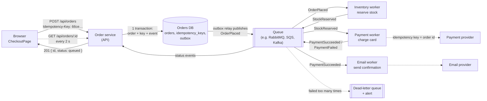
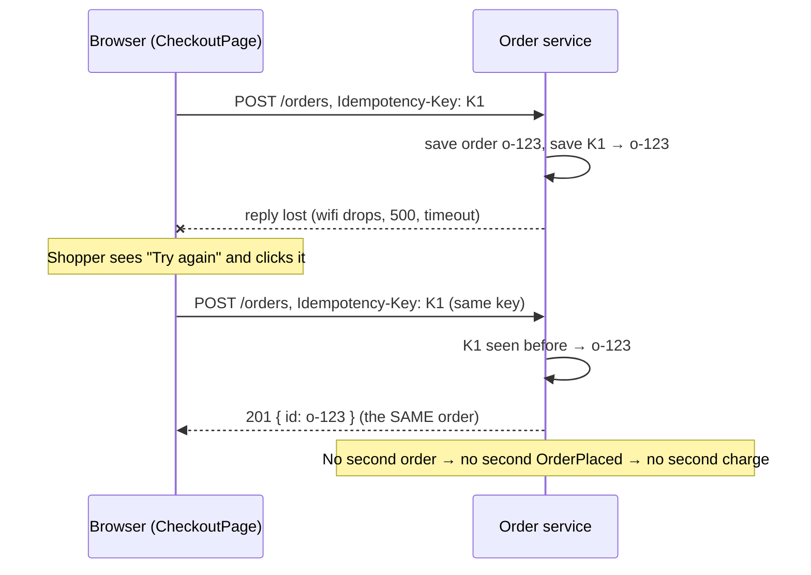

# Orders: queue design

How placing an order would work on a real backend: an **order service** puts the order on a **queue**, and three **workers** (inventory, payment, email) do the slow work in the background. The front end already behaves as if this exists: an order starts as `queued`, moves to `processing`, then `completed`, and the confirmation page polls until it's done (`src/mocks/db.ts` → `statusFor()`, `src/pages/OrderConfirmationPage.tsx`).

## 1. The diagram

### What happens, step by step

1. **The browser sends the order** with an `Idempotency-Key` (a random id made once per checkout attempt, D3-2).
2. **The order service does only the fast, must-not-fail part:** it checks the token and the request, then in **one database transaction** saves the order (`status: queued`), saves `key → order id`, and writes an `OrderPlaced` event to an **outbox** table.
3. **It answers straight away:** `201 { id, status: "queued" }`. The shopper sees the confirmation page within milliseconds, not after a card charge and an email.
4. **A small relay** reads the outbox and publishes `OrderPlaced` to the queue. (Saving the event in the same transaction as the order means we can never end up with "order saved but no message sent", or the other way round.)
5. **Inventory worker** reserves the stock for every item, all-or-nothing (like `createOrder()` in `db.ts` does today). Then it publishes `StockReserved`. If something sold out meanwhile, it publishes `StockUnavailable` and the order is cancelled before anyone is charged.
6. **Payment worker** charges the card and publishes `PaymentSucceeded` or `PaymentFailed`. On failure, the inventory worker **releases** the reserved stock (a "compensating" step: we undo step 5 instead of locking everything in one big transaction).
7. **Email worker** sends the confirmation after `PaymentSucceeded`.
8. **The order service listens to the events** and updates the status. `queued` → `processing` (stock reserved, charging) → `completed` (paid). The confirmation page sees the change on its next poll.

**Why inventory comes before payment:** we only charge for things we know we can ship. Charging first and then finding the item sold out means a refund, which costs money and annoys the customer.

**What the shopper sees today vs. in this design:** in our mock, the stock check happens immediately inside `POST /orders` and a shortage comes back as a `409` at checkout. A real system can keep that quick check for good feedback (most shortages are caught at checkout), while the inventory worker does the final, authoritative reservation. A rare race between two buyers then ends as a "cancelled, not charged" order instead of a 409.

## 2. Why a queue helps

| Without a queue (do everything inside `POST /orders`)                                              | With a queue                                                                                                            |
| -------------------------------------------------------------------------------------------------- | ----------------------------------------------------------------------------------------------------------------------- |
| The shopper waits for stock + card charge + email: several seconds, maybe a timeout                | The shopper gets an answer in milliseconds; the rest happens in the background                                          |
| If the email provider is down, the whole request fails, and maybe the card was already charged     | Email being down only delays the email (section 3)                                                                      |
| A sale (Black Friday) sends 50× the traffic straight at the payment provider, which rate-limits us | The queue **absorbs the spike**: orders wait in line and workers take them at a steady pace                             |
| Scaling means scaling everything together                                                          | Each worker **scales on its own**: add 10 payment workers, keep 1 email worker                                          |
| A crash halfway leaves the order half-done                                                         | A message is only removed after the worker confirms ("acks") it. If a worker crashes, another one gets the same message |
| Failed steps need custom retry code everywhere                                                     | The queue retries for us, with backoff, and parks repeat failures in a dead-letter queue                                |

**The price we pay:**

- **Eventual consistency.** Right after checkout the order is `queued`, not `completed`. The UI must handle that, which is exactly why the confirmation page shows the status and polls (D3-2).
- **Messages can arrive more than once** (see section 4). Every worker must be safe to run twice.
- **More moving parts to watch:** queue length, dead-letter queue size and worker errors need monitoring and alerts (`docs/monitoring.md`).

## 3. What happens if email is down

Short answer: **the order still goes through; only the email is late.**

1. The email worker tries to send and the email provider times out (or returns an error).
2. The worker **doesn't ack** the message, so the queue keeps it and **retries with exponential backoff** (e.g. 1 min, 2, 4, 8... the same idea as the live stock reconnect in `src/api/stockFeed.ts`).
3. Meanwhile, **nothing else is blocked**: stock is reserved, the card is charged, the order shows `completed` on the confirmation page and in the account. The email isn't on the critical path.
4. When the provider comes back, the next retry succeeds and the customer gets the email, late but once.
5. If it still fails after many tries (say 24 hours), the message moves to the **dead-letter queue** and an alert fires. Support can resend it, or the email can be replayed from the dead-letter queue after a fix.

**Sending it only once:** before sending, the worker checks a `sent_emails` record for `(order id, "confirmation")`, and writes it after sending. A retried message for an order that already got its email is acked and skipped. (There's a tiny window, sent but crashed before writing the record, where a customer could get the same email twice. For email that's acceptable. For payment it isn't, which is why payment has stronger protection below.)

**The same table for the other workers:**

| Worker down   | Effect                                                                                   | Shopper sees                                                                    |
| ------------- | ---------------------------------------------------------------------------------------- | ------------------------------------------------------------------------------- |
| Email         | Emails wait in the queue                                                                 | Order `completed`, email arrives later                                          |
| Payment       | Orders wait with stock reserved; reservations expire after a time limit and are released | Order stays `processing` longer                                                 |
| Inventory     | Orders wait at the first step; nobody is charged                                         | Order stays `queued` longer                                                     |
| Order service | No new orders accepted                                                                   | Checkout error: "We couldn't reach the server…", with **the same key on retry** |

## 4. How idempotency prevents double charges

A double charge needs the same order to be paid twice. There are **two places** where "the same thing twice" can happen, and the design protects both, using the same idea: **the same request carries the same key, and the server remembers the keys it has seen.**

### 4a. Browser → order service (this is D3-2, already built)

The dangerous case is not a double-click (the button is disabled while sending). It's this:

How the code does it:

- `CheckoutPage.tsx` creates the key with `crypto.randomUUID()` and keeps it in state, so **every retry of the same order sends the same key**. The key only changes after a `409` (the cart changed, so it's a new order). After a success the page closes, so the next checkout opens a fresh page with a fresh key.
- `apiSlice.ts` sends it as the `Idempotency-Key` header.
- `db.ts` `createOrder()` first looks the key up; if it's known, it returns the existing order **before** touching stock or creating anything.
- **Proven in D3-2** with the Dev panel switch "order saved, reply lost": the first attempt saved the order and showed an error, the retry sent the same key and got the same order back. Result: 1 order, stock 1 → 0 (not −1). See `docs/decisions.md#d3-2-cart`.

**In the real service:** the `idempotency_keys` table has a **unique constraint** on the key. If two retries arrive at the same moment on two servers, the database lets only one insert win; the other reads the winner's order. (Our mock doesn't need this because the browser runs JavaScript one step at a time, but a real backend with many servers does.) Keys are kept for, say, 24 hours, and are tied to the user, so one user's key can't return another user's order.

### 4b. Queue → payment worker

Queues promise **at-least-once** delivery, not exactly-once. Example: the payment worker charges the card, then crashes before acking. The queue thinks the job failed and gives the same `StockReserved` message to another worker.

Two guards stop that second charge:

1. **Pass the order id to the payment provider as its idempotency key.** Payment providers support this (for example Stripe's `Idempotency-Key` header). The second "charge o-123" call returns the first charge's result instead of charging again. This is the same pattern as 4a, one level down.
2. **A `payments` table with a unique `order_id`.** The worker checks it first: already paid → ack and skip.

### The chain, in one line

**One checkout attempt → one idempotency key → one order id → one `OrderPlaced` → one payment (keyed by the order id) → one charge.** Every step that might be repeated (a browser retry, a queue redelivery) hits a key the server has already seen and returns the earlier result instead of doing the work again.

## 5. Decisions and alternatives

- **Queue instead of doing it all in the request:** chosen for fast answers, failure isolation and independent scaling. The cost is eventual consistency, which the UI already handles with statuses and polling.
- **Steps in order (inventory → payment → email) with compensation**, rather than one big transaction across services: services can't share a database transaction, and holding locks while waiting on a card network would block other shoppers.
- **Outbox table** instead of "save the order, then publish": without it, a crash between the two leaves an order nobody processes.
- **Polling the order status** (every 2 s, what we built) instead of pushing it: simple, and an order only takes seconds. A WebSocket like the stock feed (D4-4) would also work, but isn't worth it for one screen.
- **What I'd still need to decide in a real project:** how long stock stays reserved if payment is slow, and whether a cancelled-after-checkout order should notify the shopper by email (it should) and on the confirmation page (a new `cancelled` status).
